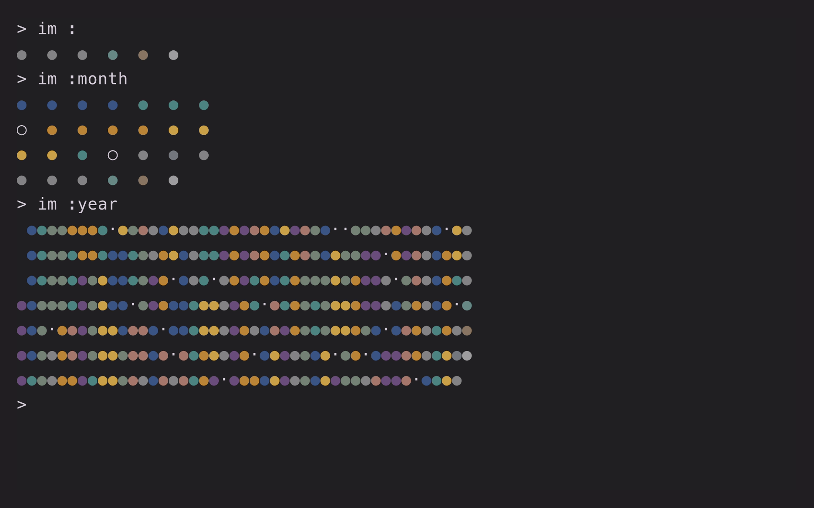
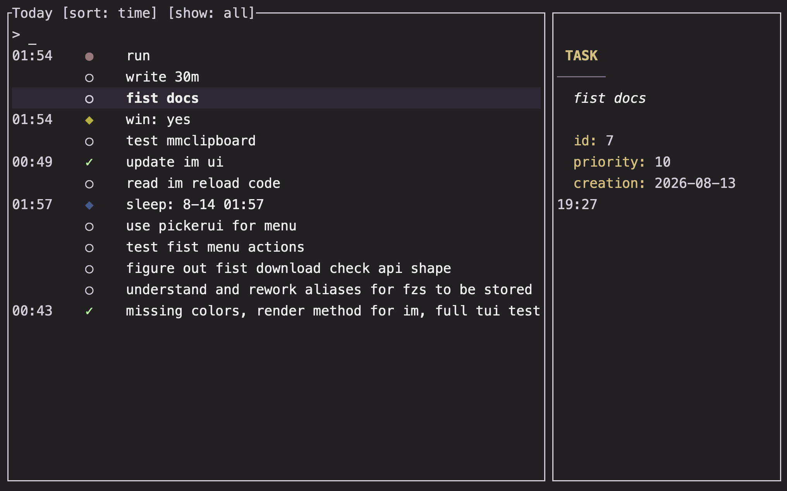

# [Im](https://www.youtube.com/watch?v=Ts0XSyWpMnU)

`im` is a CLI tool for recording all the small moments, feelings, thoughts and setbacks and accomplishments that make up your day[^1].

```console
# --- record moods and notes ---

> im worried about school tomorrow         # mood
> im sad . that my dog ate my bones        # mood with note
> im . and my cat just ate my dog          # journal entry (pure note)

# --- create tasks ---

> im +                                     # create a task (interactive)
┌  Create oneshot task
│
◇  Task name:
│  recover bones
│
◇  Edit fields:
│  Times to complete
│
◇  Times to complete:
│  10
│
◇  Edit fields:
│  Finish
│
└  Created task #1: recover bones

> im +bones defeat cat @tomorrow noon      # create a subtask (under the last task)

# --- log habits, events and trends ---

> im going to bed first                    # (declare your intentions)
> im -sleep                                # log sleep time
> im -sleep . still up                     # update logged time
> im a boneless sleepless wretch . \       # (keep up with mental health by 
> im not ready for tomorrow                # being honest with your feelings)
> im -sheep 1                              # log a sheep
> im -sheep 1                              # log another sheep
> im -sheep 1                              # continue to log sheep
> im -sheep 1                              # btw: this is a different tracker than the
>                                          # first, it accumulates entries in an interval.
>                                          # There 5 types in all. Additionally, specifying whether a tracker has an interval, has bounds, is strict, or is cumulative also changes its behavior. The first tracker can be found in the default configuration file, defined as a null tracker with a bounded interval, while the second can be assumed to be a standard integer tracker.
> im -sleep .. zzZzz

# --- check agendas & complete tasks ---

> im ready for a new day!
> im @due | cat                            # give the cat its due (displays tasks due today)
23:59   ○       defeat cat

> im alive but in pain +cat                # log mood + complete task
> im become +bones .. destroyer of cat     # update task
> im +bones 9                              # collect bones (complete task)

> im happy I found all of my bones :)
  bash: syntax error near unexpected token `)'

> im .                                     # write note in $EDITOR (a trailing . opens it)
---
happy i found all of my bones
10 on my fingers and 10 on my toes :)
---

> im ...                                   # (the No. of dots can be used to select from configured templates)
---
%% Template #3 %%
that's all of them right?
---
  
> im -thought oh no .                      # text tracker entry
---
I got Reese's Puffs in my bowl,
Now my days on cruise control,
I got Reese's Puffs in my bowl 
and just like that Im on a roll, 
[REDACTED],[REDACTED],[REDACTED],[REDACTED]
---

# --- set goals ---

> im + %1 day :regrow bones =1             # Create a recurring task with a (exceedable) target
> im @186 days from now :return to school  # Schedule future events
> im + shop: bone meal, bonebons, Skele-Gro, 99% milk # Shopping list

> im                                       # Check today's journal
[UNDER CONSTRUCTION]

# --- visualize your success with a grid --- 

> im :                                        # (the dots are colored according to the aggregate mood of your entries from that day)
◯  ●  ●  ◯  ●  ●

> im :month bones                             # recurring task progress can also be graphed
●  ●  ●  ●  ◯  ●  ●
●  ●  ◯  ●  ◯  ◯  ●                                
●  ●  ●  ●  ●  ●  ●
●  ●  ◯  ●  ●  ●

> im :month cats_defeated                     # (5 cats were harmed in the making of this transcript)
◯  ◯  ◯  ◯  ●  ◯  ◯
◯  ◯  ●  ◯  ●  ●  ◯                                   
◯  ◯  ◯  ◯  ◯  ◯  ◯
◯  ◯  ●  ◯  ◯  ◯

# reflect and repeat

im still alive . im glad
```

## Features

- Log moods and journal entries in simple, natural syntax.
  - Today view: show a ordered summary of all that you have logged and planned today -- an interactive, auto-collated daily note. 
- Grid view: Display your mood, task and tracker histories as dots.
  - Moods are colored by how much they match to various emotions or topics you have configured.
  - Change the topics, timespans, and filters, and watch as interesting patterns emerge.
- Task Management: Support for oneshot, recurring tasks and scheduled tasks.
  - Interactive views over upcoming / completed / due tasks.
  - Full featured data model supporting priorities, subtasks, optional tasks, overdue tasks and multiple completions.
- Custom Trackers: Track custom metrics with configurable intervals, ranges and colors.

## Gallery





## Usage

<!-- HELP_START -->
```
im — immediate mood, journal, and task tracker

Usage:
  im <mood> [. [body]]                           log a mood (with an optional body)
  im [-<tracker> [value]]..                      add one or more custom tracker records
  im <mood> [+task] [-trackers..]                log a mood linked with an existing task
                                                        or new tracker records
  im %<duration> [purpose..]                     start a timed session
                                                        (trackers, task & body supported)

  im +                                           create a task
  im +[parent] <name> [@<time>]                  create a task (non-interactive)
  im + %[interval] [:<name>]                     create a recurring task (interactive)
  im + @[time] [:<name>] [%<duration>]           schedule a task (interactive if partial)
  im +[task] [count]                             edit or update a task by its reference
                                                        (see `im -vh` for reference)

Views:
  im @[date]                                     today view
  im @due[:t|:w]                                 due view
                                                        (today / tomorrow / this week)
  im @[:o|:O]                                    pending tasks
                                                        (all / oneshot / recurring&scheduled)
  im @done[:o|:O]                                completed tasks
                                                        (all / oneshot / recurring&scheduled)

Trackers and grids:
  im -                                           browse trackers
  im :[week|month|year] [ids]                    dot-sequence tracker grid
                                                        ids: <tracker> or @<recurring name>
                                                        period defaults to "week"

Other:
  im :c [moods|colors|mm]                        open the config in $VISUAL / $EDITOR
  im :tool db|mood|clear|..                      (see `im :tool --help`)
  im :sync [register|login|status|logout]        setup/authenticate/run sync 


Flags:
  im -q | -v <command>                           quiet / verbose; flags go first
  im --help | -h                                 show this help (-v applies)
  im --version | -V                              show version
```
<!-- HELP_END -->

## Installation

##### Homebrew

```sh
brew install Squirreljetpack/tap/im
```

##### AUR

Unavailable

##### npm

```sh
npm install -g @squirreljetpack/im
```

## Configuration

Run `im :tool config` to open the configuration file in your `$EDITOR` or `$VISUAL`.

The default locations are in order:

- `~/.config/matchmaker/config.toml` (If the folder exists already).
- `{PLATFORM_SPECIFIC_CONFIG_DIRECTORY}/matchmaker` (Generally the same as above when on linux)

## Advanced

[`im`](https://www.youtube.com/watch?v=xP26YedHWxc) stores three types of objects:
  - moods entries: which compute an embedding that captures their semantic meaning.
  - tasks: oneshot, recurring, or scheduled.
  - trackers: defined in your configuration.


##### Moods

The most basic use of `im` for a kind of offhand journaling where you logging any moods that come to you throughout the day, such as `im happy` or `im cold`, or thoughts such as `im . maybe i should put on some pants`. They are collected in the [Today view](#views) together with other task and tracker entries from the day, and im collates them into a interactive daily journal.

Also, every mood is assigned a color, by determining its weighted semantic alignment to a set of configured _mood anchors_ (color, mood pairs), yielding pretty, meaningful dots on the interface and in the grid view[^4] that provide users with a sense of pride and accomplishment.

Finally, `im %<duration>` starts a Pomodoro session -- idk why. Personally, I find the Pomodoro method a depressing concept. Anyways, start a session, link it to a tracker or task if you want, and when time is up it will prompt you about how it went; don't answer if you don't feel like it. If you just want to create timed notifications, that's available through `im :tool notify`.

[^4]: `im :[week|month|year]`

##### Trackers

Trackers are defined in your configuration (`im :tool config`); each `[tracker.<name>]`
section is logged through `im -<name> <value>` (no value for `null` trackers):

- Kinds: `text`, `integer`, `float`, `duration` (strings like `6m 30s`), `null` (timestamp/count markers — requires an interval).
- `interval = { anchor = "2026-01-01T00:00:00", span = "1 day" }` bins
  entries into calendar slots. The anchor is an unzoned civil datetime resolved
  in your current local zone. By default, a new log in a slot replaces the slot's previous entry;
  `interval.cumulative = true` keeps every log and the slot's grid dot shows the aggregate.
  Logs record the UTC offset and location string they were written in, so that although tracker intervals shift with your zone's offset (keeping the civil time of their availability fixed), logs stay in the same interval slot.


##### Tasks

The three types of tasks share an underlying data-type, distinguished only by the presence of specific fields. _Recurring_ tasks have an interval, _scheduled_ tasks have a duration but no interval, and _oneshot_ tasks have neither.

- The interval of recurrence is a calendar-aware span (i.e. 1 day or 1 week) anchored at an absolute `start_time` [^3].
- Scheduled tasks are surfaced on such views as the Today or Due views when they are upcoming, and are completed automatically once their availability window passes. They can also be completed or cancelled early.
- Oneshot tasks and recurring tasks can both specify a (exceedable) target count.
- Tasks carry fields such as priority, parent tasks, due dates (for oneshot tasks), & task body etc. They can be specified (or edited) at creation or afterwards, through an interactive menu-style CLI prompt flow.


##### Views

The app includes 3 [TUI](https://en.wikipedia.org/wiki/Text-based_user_interface)s:

- The _Today view_ (`im`), which aggregates tasks, trackers and mood/journal entries to provide a itinery + recap of the current horizon (Today, Today + Tomorrow, This Week) -- a kind of live journal. It can be filtered to just events or upcoming due tasks.
- The _Tasks view_ (`im @`), which lists *(drum roll)* all the tasks. It can be filtered to just oneshots, or just recurring/scheduled, or to future/past/completed/incomplete etc.
- The _Tracker view_ (`im -`), from where you can select a tracker type and log an entry for it.

For a comprehensive SPEC of the rules which determine which entities make it into a specific view, see the [docs](./docs/VIEWS.md).


##### Sync

`im` stores your data in a local sqlite db. But it also supports cross-device sync by way of a central server that maintains an event log. Updates are per-field conflicts are resolved via LWW, meaning if two edits are made on the same field and afterwards synced, the one whose recorded time *as measured on-device* is later is agreed upon as the field's value. Such conflicts are surfaced in the output when running `im: sync` but *never prompt and thus erase data*. The one exception is *deletes*: deletes are final, meaning that *any* edit to a field made after a deletion of the source has been recorded in the log is ignored. For this reason, when a client contains a field update which would be dropped by pulling this event, they are prompted with the option to *resurrect* the entity as it currently exists in their local database as a safeguard.

To enable syncing, run `im :sync register` on Device A, `im :sync login` on Device B, then `im :sync` on one or both devices. Syncing does not run automatically.


## FAQ

### Why is the binary size so large?

`im` bundles a quant of `nomic-ai/nomic-embed-text-v1.5` to categorize your entries. This was the most effective, reasonably sized approach tested out of several options. The size is a bit abnormal, but was pleasantly surprised with how much better it worked compared to my other attempts.

If you are particularly idle, it can be a source of amusement or annoyance depending on your temperament. For example, `im :tool mood` assigns the following scores to `im a consummate wretch`: `humble: 0.2196, vengeful: 0.1313, proud: 0.1037, hungry: 0.0798, smitten: 0.0789`, while `im a little teapot` gets: `hungry: 0.1618, humble: 0.1586, nostalgic: 0.1285, smitten: 0.1098, comfortable: 0.0711`. So yeah, the tiny LM can have some pretty good intuition into emotional psychology at times (Note also that the saliency scores for our phrases are `0.9946` vs `0.0079` so it's wise to that trick too).


If you have any interesting uses for an embedding model that `im` can help with, `im` open to them!

### What does im stand for?

What it stands for is immaterial[^2].

### How can I contribute?
Open to suggestions. Helping implement more filters, or a sensible configurable spec for exporting to markdown would be helpful. Documentation, always.


## See also

- https://github.com/qiz-li/im
- https://docs.rs/jiff/latest/jiff/


[^1]: `im` can also help you:
    - catalogue all the goals and hopes you never got around to
    - all the tasks you missed the deadline for
    - reinforce negative thoughts
    - rationalize bad decisions
    - realize that you don't actually have any thoughts interesting enough to write down.

[^2]: important, immense, immaculate, importune, imagine all the people .. immolated♫
[^3]: This differs from trackers, whose intervals shift to follow your timezone offset: while recurring tasks with intervals in the units of days will be robust to DST, changing time-zones will likely cause their availability windows to shift in time of day. 
